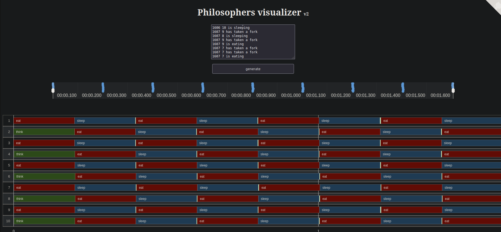

# Philosophers

This repository contains a C implementation of the classic **Dining
Philosophers** concurrency problem. It was completed as a solo school project
for Ecole 42 in October 2023.

**Result:** 100/100  
**Time spent:** about 1 month  
**Bonus:** not completed



## Project Summary

The program simulates philosophers sitting around a table. Each philosopher
repeats the same routine:

1. Think
2. Take two forks
3. Eat
4. Sleep

The catch is that every fork is shared between two neighboring philosophers.
If a philosopher cannot eat before their timer runs out, they die and the
simulation stops.

This is a small project in terms of file count, but it is mainly about
correctly handling **multithreading, timing, and shared memory**.

## How It Works

Each philosopher runs in its own POSIX thread. Forks are represented by
`pthread_mutex_t` locks, so only one philosopher can hold a fork at a time.
The main thread watches the simulation and checks whether any philosopher has
exceeded `time_to_die`.

The executable is built with:

```sh
make
```

Run it with:

```sh
./philo number_of_philosophers time_to_die time_to_eat time_to_sleep [meals_required]
```

Example:

```sh
./philo 5 800 200 200
```

The optional final argument stops the simulation once every philosopher has
eaten at least that many meals.

## What Made This Project Challenging

The hard part is not the algorithm itself, but making it reliable under many
thread schedules.

- **Deadlock prevention:** philosophers cannot all grab one fork and wait
  forever. This implementation uses different fork-grabbing orders for odd
  and even philosopher IDs.
- **Race condition control:** shared data such as `last_ate`, meal counts,
  death status, and console output are protected with mutexes.
- **Accurate timing:** the project depends on millisecond-level timing using
  `gettimeofday` and controlled `usleep` loops.
- **Synchronized startup:** threads wait behind a shared `m_ready` mutex so the
  simulation begins from a consistent start time.
- **Clean shutdown:** the program joins all philosopher threads, destroys
  mutexes, and frees allocated memory before exiting.
- **Edge cases:** the code handles invalid arguments, integer overflow checks,
  a single philosopher with only one fork, and the optional meal-count stop
  condition.

## Repository Layout

```text
.
|-- README.md
|-- README_NEW.md
|-- en.subject.pdf
|-- Makefile
|-- includes/philo.h
`-- srcs/
    |-- main_thread/
    |-- parsing/
    `-- philos/
```

## Notes

This project is a practical exercise in low-level concurrent programming. It
does not use higher-level threading abstractions, external libraries, or a
runtime scheduler. The behavior comes directly from C, POSIX threads, mutexes,
and careful coordination between threads.
